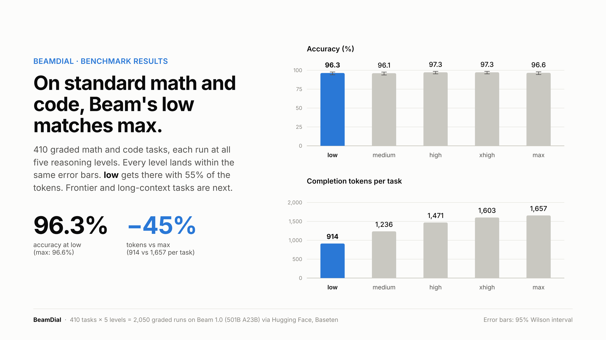
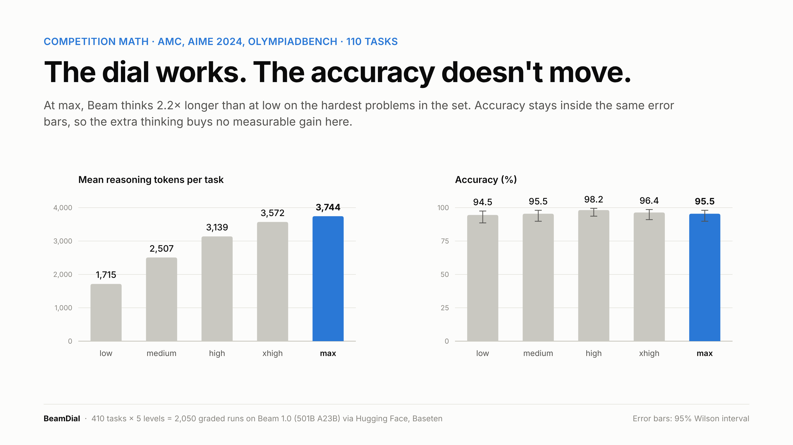
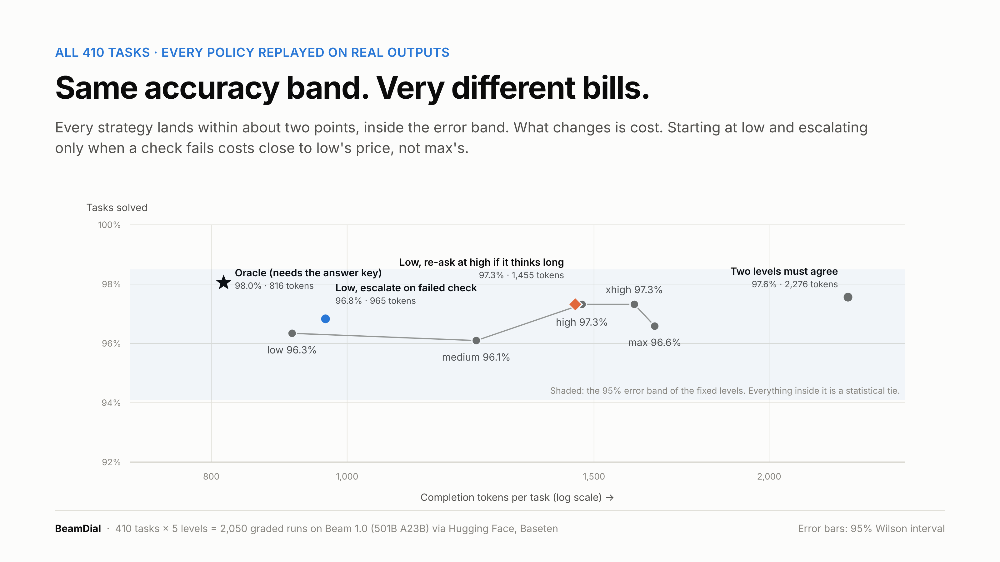
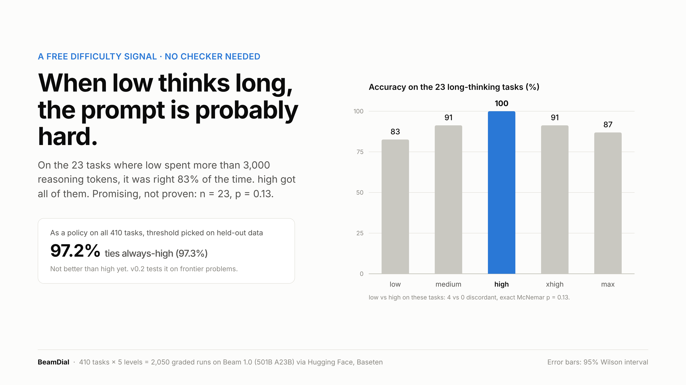
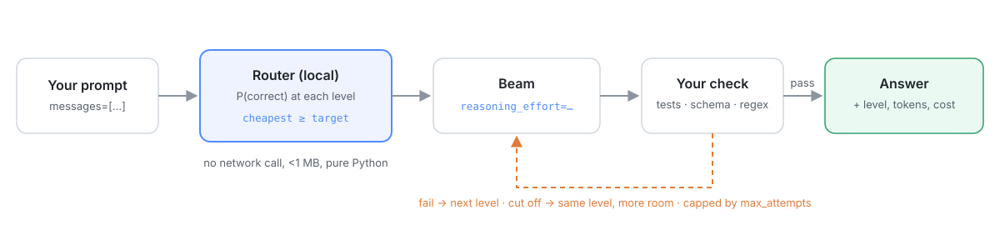

<p align="center">
  
</p>

<p align="center">
  <a href="LICENSE"></a>
  
  
  <a href="https://github.com/CoderRahul01/beamdial/actions/workflows/tests.yml"></a>
  <a href="https://huggingface.co/spaces/PengoSword123/beamdial"></a>
  <a href="https://huggingface.co/datasets/PengoSword123/beamdial-v0.1"></a>
</p>

Reflection's [Beam](https://huggingface.co/reflection/Beam-1.0-501B-A23B) has five reasoning levels, `low` to `max`. Higher levels think longer before answering, and you pay for every thinking token. Most apps pick one level and never touch it again.

I wanted to know what each level actually buys. So I ran 410 math and code tasks with known answers at all five levels, 2,050 runs, and checked every answer automatically.

**On standard math and code, `low` ties `max` on accuracy and uses 55% of the tokens.**

BeamDial is the small library that came out of it. It picks the level per request, handles a few API quirks that break Beam apps, and lets you measure the gap on your own prompts.

[Try it in the browser](https://huggingface.co/spaces/PengoSword123/beamdial) · [Get the data](https://huggingface.co/datasets/PengoSword123/beamdial-v0.1) · [Read the results](docs/07-results-and-roadmap.md)

## Results

<p align="center"></p>

| Level | Accuracy | 95% interval | Tokens per task | vs `max` |
|---|---|---|---|---|
| `low` | 96.3% | 94.1 to 97.8% | 914 | 55% |
| `medium` | 96.1% | 93.8 to 97.6% | 1,236 | 75% |
| `high` | 97.3% | 95.3 to 98.5% | 1,471 | 89% |
| `xhigh` | 97.3% | 95.3 to 98.5% | 1,603 | 97% |
| `max` | 96.6% | 94.4 to 98.0% | 1,657 | 100% |

- All five levels sit inside each other's intervals. Head to head, `low` and `max` disagree on only 7 of 410 tasks, 4 one way and 3 the other (exact McNemar p = 1.0).
- The setting does change how long Beam thinks. On competition math, `max` reasons 2.2× longer than `low`. On these tasks it just doesn't buy more right answers.
- 6 of the 8 tasks no level solved are broken benchmark items: one wrong GSM8K reference and five MBPP tests that expect things the prompt never says. They're listed in [`data/flagged_tasks.json`](data/flagged_tasks.json). On the 404 clean tasks, `low` scores 97.8%.

<details>
<summary>More charts and the full numbers</summary>





Tables: [`results/report.md`](results/report.md). Spreadsheet with live formulas: [`results/BeamDial-results-v0.1.xlsx`](results/BeamDial-results-v0.1.xlsx).
</details>

### What this does not show

- **Harder problems.** These are standard benchmarks where Beam already scores about 97%. On problems near the edge of what it can do, more thinking may well pay. That's the next run.
- **Memorization.** GSM8K, MATH, HumanEval and MBPP are old and public, so Beam has likely seen many of them in training. That can make `low` look better than it would on new problems. The next run includes freshly generated tasks that can't have been memorized.
- **Other providers and settings.** One provider (Baseten via Hugging Face), one sample per task per level, temperature 0.7.
- **Speed.** Median latency was about 1.1 s at every level. Higher levels were slower on average only because of a long tail of hard prompts.
- **A smarter router.** On this data the router's best move is almost always `low`, because that's what the data says. It only becomes interesting on data where the levels actually differ.

The point of `calibrate` (below) is that you shouldn't take any of this on trust for your own traffic.

## Install

```bash
pip install "git+https://github.com/CoderRahul01/beamdial"
```

The core has no dependencies. You bring your own OpenAI-compatible client, which is also what `calibrate` uses (`pip install openai`).

## Use

```python
from openai import OpenAI
from beamdial import BeamDial

client = OpenAI(base_url="https://router.huggingface.co/v1", api_key=HF_TOKEN)
beam = BeamDial(client)

res = beam.create(messages=[{"role": "user", "content": "How many primes are below 100?"}])
print(res.effort, res.total_tokens, res.content)
```

If you can check an answer (tests pass, JSON parses, a regex matches), BeamDial starts cheap and only moves up a level when the check fails:

```python
beam = BeamDial(client, policy="cascade", start="low")
res = beam.create(messages=msgs, verify=lambda text: my_tests_pass(text))
```

Beam rejects follow-up requests if an earlier assistant turn is missing `reasoning_content`. `to_message()` always includes it:

```python
msgs.append(res.to_message())
```

See the pick for a prompt without calling any API:

```bash
beamdial "Find all integers n such that n^2 + 1 divides n^3 + 7"
```

## Measure the gap on your own prompts

```bash
# prompts.jsonl, one per line: {"prompt": "...", "answer": "..."}
# or bring your own check: --check mymodule:my_check  (def my_check(text, row) -> bool)
beamdial calibrate prompts.jsonl --levels low,high,max --budget-usd 2
```

It runs every prompt at each level, tests whether the difference is real (exact McNemar), and prints the cheapest setting that keeps your accuracy. Results are saved as they come in, so you can stop and resume. It stops at the budget.

## What BeamDial handles

| Situation | What happens |
|---|---|
| Your check fails | Re-ask one level higher, up to `max_effort`, at most `max_attempts` calls |
| Reply cut off (`finish_reason="length"`) | Retry at the same level with double the token budget. A higher level would think longer and get cut off again |
| Reply is a tool call | Counted as success, not as an empty answer |
| Follow-up turn | `to_message()` always carries `reasoning_content`, with a placeholder if the provider dropped it |
| Prompt isn't math or code | The router wasn't trained on it, so it uses the `fallback` level instead of guessing |
| You want to know the cost | `res.total_tokens` and `res.cost_usd` include failed attempts |

<details>
<summary>All options</summary>

| Option | Default | |
|---|---|---|
| `policy` | `"router"` | `"router"`, `"cascade"` (start at `start`, climb on failure) or `"fixed"` |
| `start` | `"low"` | first level for `cascade` and `fixed` |
| `target` | `0.85` | router quality target, higher is safer and costs more |
| `fallback` | `"medium"` | level for prompts unlike the training data |
| `max_effort` | `"max"` | never go above this level |
| `max_attempts` | `3` | cap on calls per request |
| `max_tokens_cap` | `64000` | ceiling when growing the budget after a cut-off reply |
| `long_think_tokens` | off | experimental: if a cheap level thinks longer than this, re-ask once at `long_think_to` |
| `prices` | `None` | `(input, output)` USD per 1M tokens, enables `res.cost_usd` |
| `on_attempt` | `None` | callback for every call, for logging |

</details>

## How the numbers were made

<p align="center"></p>

- **Tasks:** GSM8K (40), MATH levels 1 to 5 (160), AMC 2023 (40), AIME 2024 (30), OlympiadBench (40), HumanEval (50), MBPP (50), sampled with a fixed seed.
- **Grading:** math with [math-verify](https://github.com/huggingface/Math-Verify) on the last `\boxed{}` answer. Code by running the benchmark's own tests in a separate process with a timeout.
- **Policies** like "start low, escalate on a failed check" are replayed on the real outputs, since every task was run at every level. Escalation only uses checks a developer could actually run (the visible example test), never the hidden tests.
- **Router scores** are out-of-fold: 5-fold cross-validation, plus a harder split where a whole task family is held out.

An early version of the grader marked correct answers wrong, because math-verify can't run inside worker threads and the error was counted as a miss. It's fixed, there are regression tests for it, and every number here uses the fixed grader. Details in [docs/07-results-and-roadmap.md](docs/07-results-and-roadmap.md).

## Reproduce

```bash
pip install -r requirements-analysis.txt
export HF_TOKEN=...

python scripts/probe_effort.py                       # does each provider respect reasoning_effort?
python scripts/collect.py --model reflection/Beam-1.0-501B-A23B:baseten --budget-usd 15
python scripts/grade.py data/runs.jsonl data/graded.jsonl   # runs model-written code: use a sandbox
python scripts/train_router.py data/graded.jsonl results
python scripts/analyze.py data/graded.jsonl results
```

The collector is resumable and stops at the budget. The full run cost about $3.50 at $0.40 / $1.20 per million input / output tokens.

## Docs

- [How it works](docs/02-how-it-works.md): every script and what the important lines do
- [Edge cases and trade-offs](docs/03-edge-cases-and-tradeoffs.md)
- [Checking a provider](docs/04-the-probe.md)
- [Results and roadmap](docs/07-results-and-roadmap.md)
- [Glossary](docs/06-glossary.md)

## License

Apache 2.0. Built for the [Reflection × Hugging Face Build with Beam challenge](https://huggingface.co/reflection/Beam-1.0-501B-A23B/discussions/5) by [Rahul Pandey](https://x.com/rahulpandey187).
